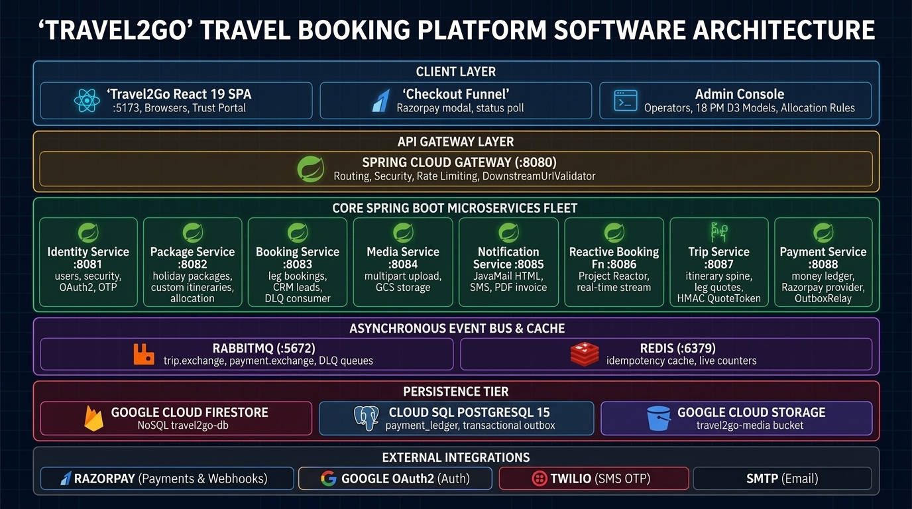
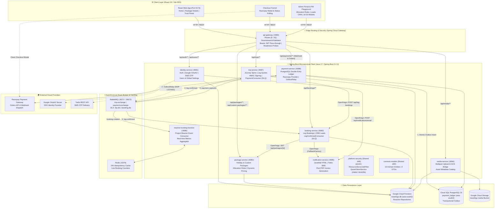
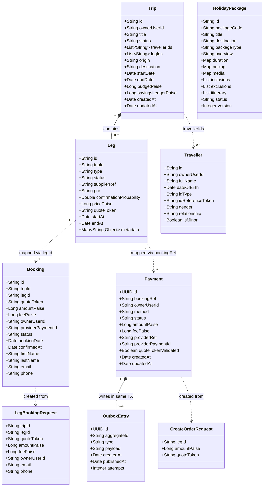
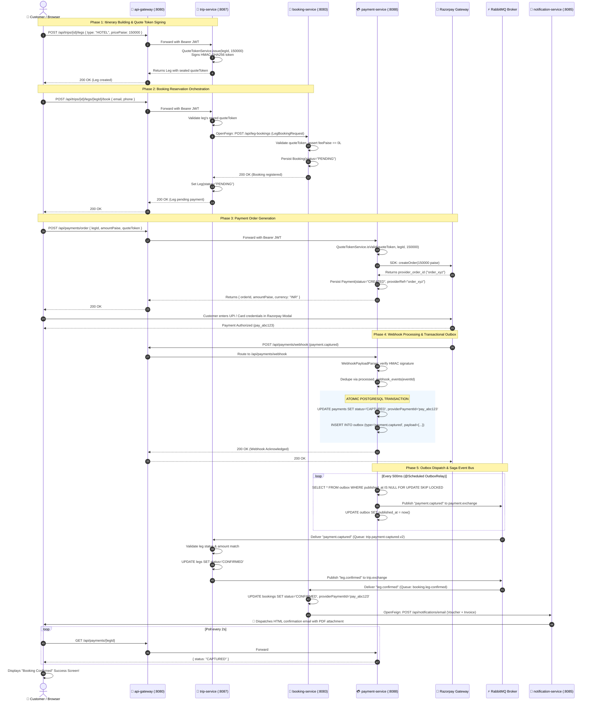
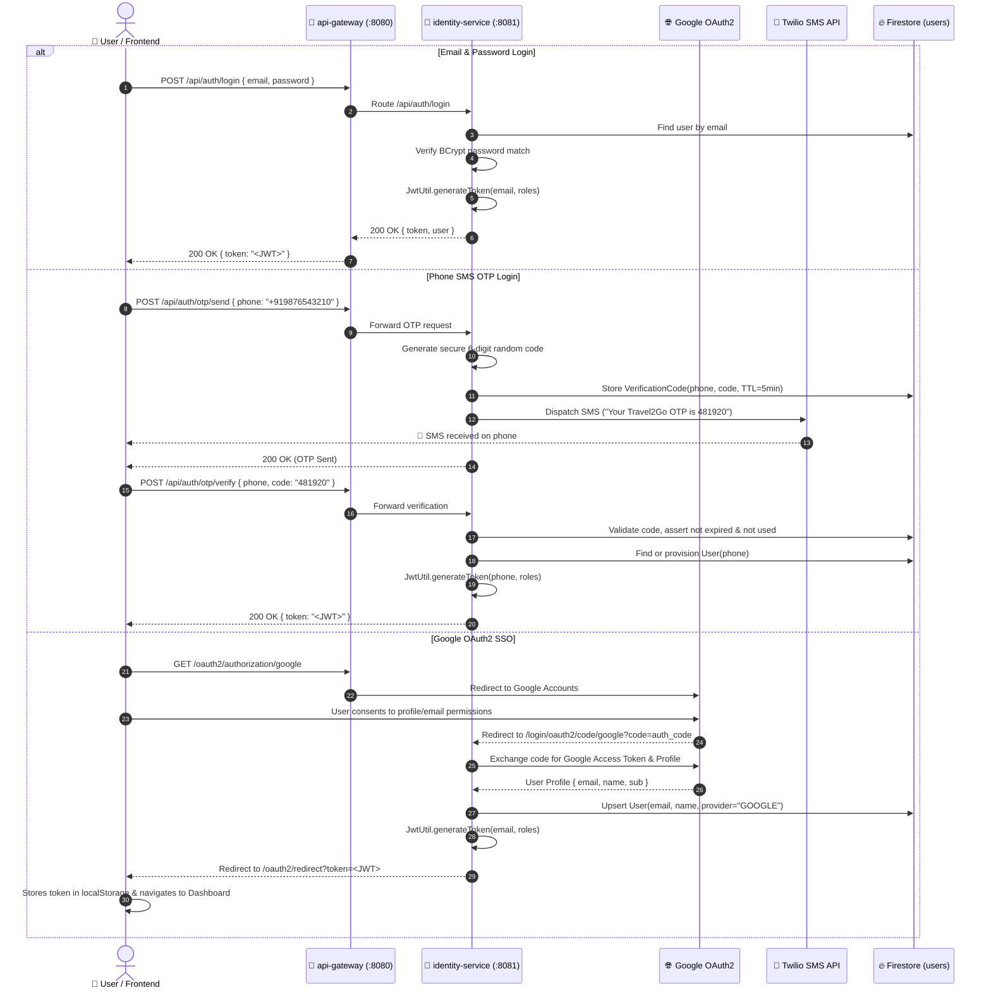
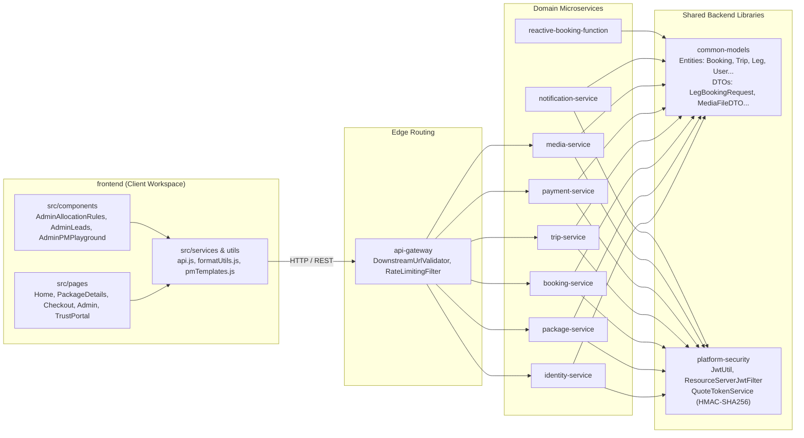

# Travel2Go — Comprehensive Component Registry & System Architecture

This document provides an exhaustive, component-by-component inventory, formal architectural specification, and UML visual modeling of the entire **Travel2Go** codebase. Every frontend component, backend microservice class, domain entity, database schema, messaging queue, infrastructure resource, and utility script is documented without omission.

---

## Table of Contents
1. [Overall System Architecture Diagram](#1-overall-system-architecture-diagram)
2. [Entity-Relationship (ER) Diagram (Data Model)](#2-entity-relationship-er-diagram-data-model)
3. [UML Class Diagrams](#3-uml-class-diagrams)
   - [3.1 Domain Models & DTO Hierarchy](#31-domain-models--dto-hierarchy)
   - [3.2 Microservices Service Layer & Security Architecture](#32-microservices-service-layer--security-architecture)
4. [UML Sequence & Saga Choreography Diagrams](#4-uml-sequence--saga-choreography-diagrams)
   - [4.1 End-to-End Checkout, Quote Token HMAC & Distributed Saga](#41-end-to-end-checkout-quote-token-hmac--distributed-saga)
   - [4.2 Authentication, Google OAuth2 & SMS OTP Flow](#42-authentication-google-oauth2--sms-otp-flow)
5. [UML Component & Package Architecture](#5-uml-component--package-architecture)
6. [Global Architectural Invariants & Guarantees](#6-global-architectural-invariants--guarantees)
7. [Frontend Components & Application Layer (`frontend/src`)](#7-frontend-components--application-layer-frontendsrc)
   - [7.1 Application Shell & Routing](#71-application-shell--routing)
   - [7.2 Consumer Pages](#72-consumer-pages)
   - [7.3 Administrative Dashboards & Pages](#73-administrative-dashboards--pages)
   - [7.4 Reusable UI & Feature Components](#74-reusable-ui--feature-components)
   - [7.5 Frontend Services & API Layer](#75-frontend-services--api-layer)
   - [7.6 Utilities & PM Framework Engine](#76-utilities--pm-framework-engine)
8. [Backend Microservices Fleet (`microservices/*`)](#8-backend-microservices-fleet-microservices)
   - [8.1 API Gateway (`api-gateway`)](#81-api-gateway-api-gateway)
   - [8.2 Identity & Access Service (`identity-service`)](#82-identity--access-service-identity-service)
   - [8.3 Package & Inventory Service (`package-service`)](#83-package--inventory-service-package-service)
   - [8.4 Booking & CRM Service (`booking-service`)](#84-booking--crm-service-booking-service)
   - [8.5 Trip & Itinerary Service (`trip-service`)](#85-trip--itinerary-service-trip-service)
   - [8.6 Payment & Money Ledger Service (`payment-service`)](#86-payment--money-ledger-service-payment-service)
   - [8.7 Media Storage Service (`media-service`)](#87-media-storage-service-media-service)
   - [8.8 Notification & Dispatch Service (`notification-service`)](#88-notification--dispatch-service-notification-service)
   - [8.9 Reactive Stream & Cache Function (`reactive-booking-function`)](#89-reactive-stream--cache-function-reactive-booking-function)
   - [8.10 Central Security Module (`platform-security`)](#810-central-security-module-platform-security)
   - [8.11 Shared Domain Models & DTOs (`common-models`)](#811-shared-domain-models--dtos-common-models)
9. [Data Stores & Persistence Schemas](#9-data-stores--persistence-schemas)
   - [9.1 Google Cloud Firestore (`travel2go-db`)](#91-google-cloud-firestore-travel2go-db)
   - [9.2 Cloud SQL PostgreSQL Ledger (`payment_ledger`)](#92-cloud-sql-postgresql-ledger-payment_ledger)
   - [9.3 Redis Cache](#93-redis-cache)
   - [9.4 Google Cloud Storage](#94-google-cloud-storage)
10. [Asynchronous Event Topology (RabbitMQ)](#10-asynchronous-event-topology-rabbitmq)
11. [Infrastructure as Code, CI/CD & DevOps](#11-infrastructure-as-code-cicd--devops)
12. [Standalone Tools & Testing Scripts](#12-standalone-tools--testing-scripts)

---

## 1. Overall System Architecture Diagram





---

## 2. Entity-Relationship (ER) Diagram (Data Model)

The data tier is hybrid: Google Cloud Firestore stores schemaless reactive documents for users, itineraries, and bookings; Cloud SQL PostgreSQL maintains an ACID-compliant double-entry ledger with an outbox table for payment events.

```mermaid
erDiagram
    %% ==========================================
    %% FIRESTORE COLLECTIONS
    %% ==========================================
    
    USER ||--o{ TRIP : "owns"
    USER ||--o{ TRAVELLER : "manages"
    USER ||--o{ TRAVELLER_GROUP : "creates"
    USER ||--o{ VERIFICATION_CODE : "receives"
    USER ||--o{ CUSTOM_PACKAGE : "designs"

    TRIP ||--|{ LEG : "contains"
    TRAVELLER_GROUP }o--o{ TRAVELLER : "includes"
    
    LEG ||--o| BOOKING : "reserved as (legId)"
    LEG ||--o| PAYMENT : "paid via (booking_ref)"
    
    LEAD ||--o{ LEAD_ACTIVITY : "tracks"
    LEAD ||--o{ LEAD_AUDIT_LOG : "audits"
    
    CONFIGURATOR_CATEGORY ||--o{ ALLOCATION_RULE : "configures"

    %% ==========================================
    %% POSTGRESQL TABLES (payment-service)
    %% ==========================================
    PAYMENT ||--o{ REFUND : "has"
    PAYMENT ||--o{ SETTLEMENT : "settled via"
    PAYMENT ||--o| OUTBOX_ENTRY : "triggers event"

    USER {
        string id PK "Document ID"
        string name "Full Name"
        string email "Unique Email"
        string phone "E.164 Phone"
        string password "BCrypt Hash"
        string[] roles "ROLE_USER, ROLE_ADMIN"
        string provider "LOCAL | GOOGLE"
        boolean active "Account Status"
        date createdAt "Timestamp"
    }

    VERIFICATION_CODE {
        string id PK "Document ID"
        string email "Target Email"
        string phone "Target Phone"
        string code "6-Digit Secret"
        string type "PASSWORD_RESET | LOGIN_OTP"
        date expiresAt "TTL Expiration"
        boolean used "One-time flag"
    }

    TRIP {
        string id PK "Document ID"
        string ownerUserId FK "User reference"
        string title "Trip Title"
        string status "DRAFT|BOOKED|IN_PROGRESS|COMPLETED"
        string[] travellerIds "Traveller References"
        string[] legIds "Leg References"
        string origin "Departure Location"
        string destination "Arrival Location"
        date startDate "Trip Start"
        date endDate "Trip End"
        long budgetPaise "Target Budget"
        long savingsLedgerPaise "Savings Amount"
        date createdAt "Creation Timestamp"
        date updatedAt "Mutation Timestamp"
    }

    LEG {
        string id PK "Document ID"
        string tripId FK "Parent Trip ID"
        string type "RAIL | BUS | HOTEL | FLIGHT | PACKAGE"
        string status "SEARCHING|SELECTED|WAITLISTED|PENDING|CONFIRMED"
        string supplierRef "External Supplier Ref"
        string pnr "PNR Number"
        double confirmationProbability "ML Probability"
        long pricePaise "Price in Paise"
        string quoteToken "HMAC-SHA256 Signed Token"
        date startAt "Segment Start"
        date endAt "Segment End"
        map metadata "Segment Context"
    }

    TRAVELLER {
        string id PK "Document ID"
        string ownerUserId FK "User Reference"
        string fullName "Legal Name"
        date dateOfBirth "DOB"
        string idType "AADHAAR|PASSPORT|DL|OTHER"
        string idReferenceToken "Tokenized ID (DPDP)"
        string gender "MALE | FEMALE | OTHER"
        string relationship "SELF|SPOUSE|CHILD|PARENT"
        boolean isMinor "Minor Flag"
    }

    TRAVELLER_GROUP {
        string id PK "Document ID"
        string ownerUserId FK "User Reference"
        string name "Group Name"
        string[] travellerIds "Member IDs"
    }

    BOOKING {
        string id PK "Document ID"
        string tripId "Nullable Trip ID"
        string legId "Nullable Leg ID"
        string quoteToken "HMAC Token"
        long amountPaise "Gross Amount"
        long feePaise "0L (Invariant G1)"
        string ownerUserId "Buyer User ID"
        string providerPaymentId "Razorpay Pay ID"
        string status "PENDING|CONFIRMED|REJECTED|CANCELLED"
        date bookingDate "Creation Date"
        date confirmedAt "Confirmation Date"
        string firstName "Contact First Name"
        string lastName "Contact Last Name"
        string email "Contact Email"
        string phone "Contact Phone"
        string packageId "Package ID (Legacy)"
        string packageTitle "Package Name"
    }

    HOLIDAY_PACKAGE {
        string id PK "Document ID"
        string packageCode "Unique Code"
        string title "Package Title"
        string destination "Destination City/Region"
        string packageType "Domestic | International"
        string overview "HTML Description"
        map duration "days, nights"
        map pricing "basePrice, discount, finalPrice"
        map media "thumbnailUrl, galleryUrls"
        string[] inclusions "Included Items"
        string[] exclusions "Excluded Items"
        map[] itinerary "Day-wise Activities"
        string status "ACTIVE | INACTIVE"
        int version "Optimistic Lock"
    }

    CUSTOM_PACKAGE {
        string id PK "Document ID"
        string packageCode "Custom Code"
        string title "Custom Package Name"
        string destination "Destination"
        int days "Total Days"
        int nights "Total Nights"
        map[] itinerary "Custom Days"
        long totalPrice "Total Cost"
        string userId FK "Creator User"
        string status "SAVED | QUOTED"
    }

    ALLOCATION_RULE {
        string id PK "Document ID"
        string ruleType "HOTEL | TRANSPORT"
        int minPax "Min Passengers"
        int maxPax "Max Passengers"
        int adults "Adult Count"
        int cwb "Child With Bed"
        int cnb "Child No Bed"
        int infants "Infant Count"
        map allocationConfig "Rooms / Vehicle Matrix"
    }

    CONFIGURATOR_CATEGORY {
        string id PK "Document ID"
        string name "Category Name"
        string categoryCode "Unique Category Code"
        string description "Category Purpose"
        string icon "Lucide Icon Name"
        map[] options "Available Add-on Options"
        string status "ACTIVE | INACTIVE"
    }

    LEAD {
        string id PK "Document ID"
        string fullName "Customer Name"
        string email "Customer Email"
        string phone "Customer Phone"
        string destination "Target Destination"
        date travelDate "Target Date"
        int paxCount "Passenger Count"
        long budget "Customer Budget"
        string status "NEW|CONTACTED|PROPOSAL_SENT|WON|LOST"
        string assignedTo "Sales Agent Email"
        date createdAt "Inquiry Date"
    }

    LEAD_ACTIVITY {
        string id PK "Document ID"
        string leadId FK "Parent Lead ID"
        string type "CALL | EMAIL | NOTE | STATUS_CHANGE"
        string notes "Agent Details"
        string agentEmail "Author Agent"
        date createdAt "Timestamp"
    }

    LEAD_AUDIT_LOG {
        string id PK "Document ID"
        string leadId FK "Parent Lead ID"
        string fieldName "Modified Attribute"
        string oldValue "Prior Value"
        string newValue "Updated Value"
        date changedAt "Timestamp"
    }

    GLOBAL_SETTINGS {
        string id PK "Document ID"
        string termsAndConditions "Terms HTML"
        string privacyPolicy "Privacy HTML"
        string supportEmail "Platform Email"
        string supportPhone "Platform Phone"
        date updatedAt "Update Date"
    }

    PAYMENT {
        uuid id PK "UUID gen_random_uuid()"
        string booking_ref "Leg ID Reference"
        string owner_user_id "Buyer User ID"
        string status "CREATED|CAPTURED|FAILED|REFUNDED"
        bigint amount_paise "Gross Amount"
        bigint fee_paise "0L (Invariant G1)"
        string method "UPI | CARD | NETBANKING"
        string provider_order_id "Unique Razorpay Order"
        string provider_payment_id "Unique Razorpay Payment"
        boolean quote_token_validated "HMAC Valid Flag"
        timestamp created_at "Creation Date"
        timestamp updated_at "Update Date"
    }

    OUTBOX_ENTRY {
        uuid id PK "UUID gen_random_uuid()"
        string aggregate_id "Entity Reference"
        string type "payment.captured | payment.refunded"
        jsonb payload "Event Payload JSON"
        timestamp created_at "Creation Date"
        timestamp published_at "NULL until sent"
        int attempts "Retry Attempt Count"
    }

    PROCESSED_WEBHOOK_EVENT {
        string event_id PK "Razorpay Event ID (Dedupe)"
        timestamp processed_at "Processing Timestamp"
    }

    REFUND {
        uuid id PK "UUID gen_random_uuid()"
        uuid payment_id FK "Parent Payment UUID"
        string provider_refund_id "Razorpay Refund ID"
        bigint amount_paise "Refund Amount"
        string status "INITIATED | PROCESSED"
        timestamp created_at "Timestamp"
    }

    SETTLEMENT {
        uuid id PK "UUID gen_random_uuid()"
        uuid payment_id FK "Parent Payment UUID"
        string provider_settlement_id "Bank Settlement Ref"
        bigint amount_paise "Settled Amount"
        timestamp settled_at "Bank Clearance Date"
        string status "SETTLED | ON_HOLD"
    }
```



---

## 3. UML Class Diagrams

### 3.1 Domain Models & DTO Hierarchy



---

### 3.2 Microservices Service Layer & Security Architecture

```mermaid
classDiagram
    direction TB

    %% API Gateway Layer
    class DownstreamUrlValidator {
        -Map~String,String~ requiredUrls
        +run(ApplicationArguments args) void
    }

    %% Security Module
    class JwtUtil {
        -String secret
        -long jwtExpirationMs
        +generateToken(String username, List~String~ roles) String
        +extractUsername(String token) String
        +extractRoles(String token) List~SimpleGrantedAuthority~
        +validateToken(String token) boolean
    }

    class QuoteTokenService {
        -String secret
        -long ttlMs
        +issue(String legId, long pricePaise) String
        +isValid(String token, String legId, long pricePaise) boolean
        -validateSecret() void
    }

    class ResourceServerJwtAuthenticationFilter {
        -JwtUtil jwtUtil
        #doFilterInternal(HttpServletRequest, HttpServletResponse, FilterChain) void
    }

    %% Trip Service
    class TripController {
        -TripService tripService
        +createTrip(CreateTripRequest) Trip
        +getTripDetail(String id) TripDetailResponse
        +addLeg(String id, AddLegRequest) Leg
        +bookLeg(String id, String legId) Leg
    }

    class TripService {
        -TripRepository tripRepository
        -LegRepository legRepository
        -BookingClient bookingClient
        -TripEventPublisher eventPublisher
        -QuoteTokenService quoteTokenService
        +createTrip(CreateTripRequest, String ownerId) Trip
        +addLeg(String tripId, AddLegRequest) Leg
        +bookLeg(String tripId, String legId, String ownerId) Leg
    }

    class PaymentCapturedConsumer {
        -LegRepository legRepository
        -TripEventPublisher tripEventPublisher
        +onPaymentCaptured(PaymentCapturedEvent) void
    }

    %% Booking Service
    class LegBookingController {
        -LegBookingService legBookingService
        +bookLeg(LegBookingRequest) LegBookingResponse
    }

    class LegBookingService {
        -BookingRepository bookingRepository
        -QuoteTokenService quoteTokenService
        +createLegBooking(tripId, legId, quoteToken, amountPaise, ownerId, email, phone) Booking
    }

    class LegConfirmedConsumer {
        -BookingRepository bookingRepository
        -NotificationClient notificationClient
        +onLegConfirmed(LegConfirmedEvent) void
    }

    %% Payment Service
    class PaymentController {
        -PaymentService paymentService
        +createOrder(CreateOrderRequest) CreatedOrder
        +getPaymentStatus(String bookingRef) Map
        +handleWebhook(String payload, String signature) ResponseEntity
    }

    class PaymentService {
        -PaymentRepository paymentRepository
        -OutboxRepository outboxRepository
        -ProcessedWebhookEventRepository eventRepository
        -PaymentProvider paymentProvider
        -QuoteTokenService quoteTokenService
        +createOrder(legId, amountPaise, quoteToken, ownerId) CreatedOrder
        +handleWebhook(payload, signature) void
    }

    class OutboxRelay {
        -OutboxRepository outboxRepository
        -PaymentEventPublisher publisher
        +relayUnpublishedEvents() void
    }

    %% Cross-service Wiring
    ResourceServerJwtAuthenticationFilter --> JwtUtil : validates tokens
    TripService --> QuoteTokenService : issues tokens (addLeg)
    LegBookingService --> QuoteTokenService : validates tokens
    PaymentService --> QuoteTokenService : validates tokens (createOrder)
    
    TripController --> TripService
    TripService --> PaymentCapturedConsumer : listens for payment
    LegBookingController --> LegBookingService
    LegBookingService --> LegConfirmedConsumer : listens for leg confirmation
    PaymentController --> PaymentService
    PaymentService --> OutboxRelay : produces outbox rows
```



---

## 4. UML Sequence & Saga Choreography Diagrams

### 4.1 End-to-End Checkout, Quote Token HMAC & Distributed Saga

The following sequence illustrates how Travel2Go orchestrates a reservation across 4 microservices with cryptographic quote integrity, transactional outbox persistence, and RabbitMQ dead-letter retry safety.



---

### 4.2 Authentication, Google OAuth2 & SMS OTP Flow



---

## 5. UML Component & Package Architecture



---

## 6. Global Architectural Invariants & Guarantees

Travel2Go is governed by three strict non-negotiable invariants:

* **Invariant G1 (Zero Convenience Fee):** All currency amounts across all layers (database, DTOs, Feign clients, and user interfaces) are stored and manipulated as `Long` **paise** (1 INR = 100 paise). The booking or convenience fee (`feePaise`) on any payment, booking, or quote record must strictly evaluate to `0L`. Automated tests (`QuoteTokenServiceTest`, `PaymentServiceTest`) continuously verify this constraint.
* **Invariant G2 (Tamper-Proof Quote Token):** Client applications are strictly untrusted regarding pricing. At quotation time, `trip-service` issues an HMAC-SHA256 token encoding `{ legId, pricePaise }` with a 15-minute TTL. Any subsequent booking or payment request must present this valid token; manual tampering or price modifications trigger an immediate rejection with `LegBookingRejectedException`.
* **Transactional Outbox & Saga Pattern:** The money ledger in `payment-service` writes financial ledger changes and outbox events in a single PostgreSQL atomic transaction. The background poller (`OutboxRelay`) guarantees at-least-once delivery to RabbitMQ using `SKIP LOCKED`, while downstream consumers implement idempotent status guards and Dead Letter Queues (DLQ).

---

## 7. Frontend Components & Application Layer (`frontend/src`)

The client application is built with React 19 and Vite, styled using modern vanilla CSS with glassmorphism aesthetics, dynamic SVG icons (`lucide-react`), rich-text editing (`react-quill-new`), and D3 data visualizations.

### 7.1 Application Shell & Routing

| Component | File Path | Type | Role & Responsibilities |
| :--- | :--- | :--- | :--- |
| **`main.jsx`** | [main.jsx](file:///c:/Users/Amit%20Grover/OneDrive%20-%20IIM%20Shillong/Desktop/Travel2Go/frontend/src/main.jsx) | Root Entry | Bootstraps the React DOM tree into `#root`, applies strict mode, and loads root CSS styling. |
| **`App.jsx`** | [App.jsx](file:///c:/Users/Amit%20Grover/OneDrive%20-%20IIM%20Shillong/Desktop/Travel2Go/frontend/src/App.jsx) | Router Container | Defines application routing via `react-router-dom`, embeds the global `Toaster` notification container, and implements the `ProtectedRoute` higher-order component checking `localStorage.getItem('token')`. |
| **`index.css`** | [index.css](file:///c:/Users/Amit%20Grover/OneDrive%20-%20IIM%20Shillong/Desktop/Travel2Go/frontend/src/index.css) | Global Styles | Core design tokens: dark/light theme CSS variables, HSL color ramps, typography rules, glassmorphism cards, responsive breakpoints, and reset rules. |
| **`App.css`** | [App.css](file:///c:/Users/Amit%20Grover/OneDrive%20-%20IIM%20Shillong/Desktop/Travel2Go/frontend/src/App.css) | Layout Styles | Structural CSS utility classes, container boundaries, navbar/footer layout heights, and animation transitions. |

### 7.2 Consumer Pages

| Page Component | File Path | Route | Role & Responsibilities |
| :--- | :--- | :--- | :--- |
| **`Home.jsx`** | [Home.jsx](file:///c:/Users/Amit%20Grover/OneDrive%20-%20IIM%20Shillong/Desktop/Travel2Go/frontend/src/pages/Home.jsx) | `/` | Consumer homepage. Renders hero banners, destination tabs (Domestic vs International), package preview cards, promotional zero-fee badges, and retrieves live package inventories via `/packages`. |
| **`PackageDetails.jsx`** | [PackageDetails.jsx](file:///c:/Users/Amit%20Grover/OneDrive%20-%20IIM%20Shillong/Desktop/Travel2Go/frontend/src/pages/PackageDetails.jsx) | `/packages/:id` | Full holiday package specification. Renders day-by-day itineraries with contextual icons (flights, hotels, meals, sightseeing), photo galleries, inclusions/exclusions, pricing breakdowns, dynamic room/guest configurators, and booking lead submission modals. |
| **`Checkout.jsx`** | [Checkout.jsx](file:///c:/Users/Amit%20Grover/OneDrive%20-%20IIM%20Shillong/Desktop/Travel2Go/frontend/src/pages/Checkout.jsx) | `/checkout` | Complete end-to-end checkout funnel. Dynamically injects Razorpay Checkout SDK, creates Trip & Leg via API, books the leg with passenger contact details, requests Razorpay payment order, opens the checkout modal, and polls payment confirmation status. |
| **`TrustPortal.jsx`** | [TrustPortal.jsx](file:///c:/Users/Amit%20Grover/OneDrive%20-%20IIM%20Shillong/Desktop/Travel2Go/frontend/src/pages/TrustPortal.jsx) | `/trust` | Consumer transparency hub featuring: (1) Waitlist Confirmation Predictor with simulation algorithms, (2) 72-Hour Refund SLA dashboard with real-time countdown timers, and (3) Zero-Fee Savings Calculator comparing Travel2Go to OTA competitors. |
| **`Login.jsx`** | [Login.jsx](file:///c:/Users/Amit%20Grover/OneDrive%20-%20IIM%20Shillong/Desktop/Travel2Go/frontend/src/pages/Login.jsx) | `/login` | Multi-method authentication page supporting email/password sign-in, Google OAuth2 single-click login, and phone OTP login (request OTP, 60s countdown resend, and verify OTP). |
| **`Register.jsx`** | [Register.jsx](file:///c:/Users/Amit%20Grover/OneDrive%20-%20IIM%20Shillong/Desktop/Travel2Go/frontend/src/pages/Register.jsx) | `/register` | New customer onboarding form collecting name, email, mobile phone, password, and terms acceptance. Dispatches `POST /api/auth/register`. |
| **`ForgotPassword.jsx`** | [ForgotPassword.jsx](file:///c:/Users/Amit%20Grover/OneDrive%20-%20IIM%20Shillong/Desktop/Travel2Go/frontend/src/pages/ForgotPassword.jsx) | `/forgot-password` | Self-service credential recovery. Requests a 6-digit verification code to the registered email and submits code verification alongside the new password. |
| **`OAuth2RedirectHandler.jsx`** | [OAuth2RedirectHandler.jsx](file:///c:/Users/Amit%20Grover/OneDrive%20-%20IIM%20Shillong/Desktop/Travel2Go/frontend/src/pages/OAuth2RedirectHandler.jsx) | `/oauth2/redirect` | Callback capture for Google OAuth2. Extracts JWT token parameter from redirect URL query strings, stores it in `localStorage`, and routes the user to `/admin` or `/`. |

### 7.3 Administrative Dashboards & Pages

| Admin Component | File Path | Route | Role & Responsibilities |
| :--- | :--- | :--- | :--- |
| **`Admin.jsx`** | [Admin.jsx](file:///c:/Users/Amit%20Grover/OneDrive%20-%20IIM%20Shillong/Desktop/Travel2Go/frontend/src/pages/Admin.jsx) | `/admin` | Primary administrative workspace. Hosts tabbed navigation across Packages, Custom Packages, Leads CRM, User Accounts, Configurator, Allocation Rules, Global Settings, and PM Playground. Includes package cloning, rich-text editing (`ReactQuill`), day-wise itinerary builder, and image selector. |
| **`ImageGallery.jsx`** | [ImageGallery.jsx](file:///c:/Users/Amit%20Grover/OneDrive%20-%20IIM%20Shillong/Desktop/Travel2Go/frontend/src/pages/ImageGallery.jsx) | `/admin/images` | Media asset repository. Displays all images hosted in Google Cloud Storage via `/media/all`, filters by custom metadata tags, provides single-click URL copying, and supports multi-file drag-and-drop upload. |

### 7.4 Reusable UI & Feature Components

| Component | File Path | Role & Responsibilities |
| :--- | :--- | :--- |
| **`AdminAllocationRules.jsx`** | [AdminAllocationRules.jsx](file:///c:/Users/Amit%20Grover/OneDrive%20-%20IIM%20Shillong/Desktop/Travel2Go/frontend/src/components/AdminAllocationRules.jsx) | Manages automated hotel room and vehicle capacity rules based on guest passenger counts and demographic tiers (Adult, Child With Bed, Child No Bed, Infant). |
| **`AdminConfigurator.jsx`** | [AdminConfigurator.jsx](file:///c:/Users/Amit%20Grover/OneDrive%20-%20IIM%20Shillong/Desktop/Travel2Go/frontend/src/components/AdminConfigurator.jsx) | Interactive package configurator engine for dynamically adding itinerary days, custom activities, hotel tiers, transfers, meals, and computing live pricing. |
| **`AdminConfiguratorCategories.jsx`** | [AdminConfiguratorCategories.jsx](file:///c:/Users/Amit%20Grover/OneDrive%20-%20IIM%20Shillong/Desktop/Travel2Go/frontend/src/components/AdminConfiguratorCategories.jsx) | Configuration category builder for creating reusable add-on options (e.g., adventure sports, meal upgrades, transport types, room categories) with icons and base pricing. |
| **`AdminLeads.jsx`** | [AdminLeads.jsx](file:///c:/Users/Amit%20Grover/OneDrive%20-%20IIM%20Shillong/Desktop/Travel2Go/frontend/src/components/AdminLeads.jsx) | CRM lead management interface. Tracks customer travel inquiries, logs agent interactions and phone calls, updates lifecycle status (NEW, CONTACTED, PROPOSAL_SENT, WON, LOST), and reviews audit trails. |
| **`AdminPMPlayground.jsx`** | [AdminPMPlayground.jsx](file:///c:/Users/Amit%20Grover/OneDrive%20-%20IIM%20Shillong/Desktop/Travel2Go/frontend/src/components/AdminPMPlayground.jsx) | Enterprise Product Management workspace featuring live mathematical models, interactive D3 charts, dynamic table editing, preset restoration, and CSV exporting across 18 frameworks. |
| **`AdminUsers.jsx`** | [AdminUsers.jsx](file:///c:/Users/Amit%20Grover/OneDrive%20-%20IIM%20Shillong/Desktop/Travel2Go/frontend/src/components/AdminUsers.jsx) | User administration panel. Lists registered accounts, toggles user activation status, promotes/demotes roles (`ROLE_USER`, `ROLE_ADMIN`), and filters users. |
| **`MainLayout.jsx`** | [MainLayout.jsx](file:///c:/Users/Amit%20Grover/OneDrive%20-%20IIM%20Shillong/Desktop/Travel2Go/frontend/src/components/MainLayout.jsx) | Outer layout wrapper rendering the universal `Navbar` header and main content container. |
| **`Navbar.jsx`** | [Navbar.jsx](file:///c:/Users/Amit%20Grover/OneDrive%20-%20IIM%20Shillong/Desktop/Travel2Go/frontend/src/components/Navbar.jsx) | Top navigation header displaying brand logo, navigation links (Packages, Trust Portal, Admin Dashboard), user profile chip, and Login/Logout action buttons. |
| **`SEO.jsx`** | [SEO.jsx](file:///c:/Users/Amit%20Grover/OneDrive%20-%20IIM%20Shillong/Desktop/Travel2Go/frontend/src/components/SEO.jsx) | Dynamic head tag management. Sets document `title`, `meta[name="description"]`, Open Graph (`og:title`, `og:image`, `og:description`), and Twitter card metadata for search engine optimization. |
| **`SkeletonLoader.jsx`** | [SkeletonLoader.jsx](file:///c:/Users/Amit%20Grover/OneDrive%20-%20IIM%20Shillong/Desktop/Travel2Go/frontend/src/components/SkeletonLoader.jsx) | Shimmer placeholder components for smoother UX during data fetching (`HomeSkeleton`, `PackageDetailsSkeleton`, `AdminSkeleton`, `GallerySkeleton`, `TableSkeleton`, `CardSkeleton`). |

### 7.5 Frontend Services & API Layer

| File | File Path | Role & Responsibilities |
| :--- | :--- | :--- |
| **`api.js`** | [api.js](file:///c:/Users/Amit%20Grover/OneDrive%20-%20IIM%20Shillong/Desktop/Travel2Go/frontend/src/services/api.js) | Centralized HTTP client configured via Axios. Key responsibilities: (1) Dynamically resolves gateway base URL (`/api` or `http://localhost:8080/api`), (2) Automatically injects `Authorization: Bearer <token>` on all outbound requests, (3) Handles 401/403 responses with loop prevention for public endpoints, (4) Exports domain SDK functions: `createTrip`, `addLeg`, `bookLeg`, `createPaymentOrder`, and `getPaymentStatus`. |

### 7.6 Utilities & PM Framework Engine

| File | File Path | Role & Responsibilities |
| :--- | :--- | :--- |
| **`formatUtils.js`** | [formatUtils.js](file:///c:/Users/Amit%20Grover/OneDrive%20-%20IIM%20Shillong/Desktop/Travel2Go/frontend/src/utils/formatUtils.js) | Formatting and sanitization helpers: `formatCurrency` (Indian numbering system format), `numberToWords` (converts integer rupee amounts into words with Lakhs and Crores), `isHtmlEmpty`, and `cleanHtmlForDisplay` (DOMPurify HTML sanitizer). |
| **`pmTemplates.js`** | [pmTemplates.js](file:///c:/Users/Amit%20Grover/OneDrive%20-%20IIM%20Shillong/Desktop/Travel2Go/frontend/src/utils/pmTemplates.js) | Complete data models, default datasets, validation parameters, and calculation formulas for **18 PM Frameworks**: RICE Scoring, Weighted Scoring, Value vs Effort, Kano Model, WSJF, MoSCoW, Opportunity Scoring, BCG Matrix, Ansoff Matrix, Porter's 5 Forces, North Star Metric, AARRR Pirate Metrics, HEART Framework, Unit Economics, Cohort Retention, PMF Survey, A/B Test Calculator, and OKR Tracker. |

---

## 8. Backend Microservices Fleet (`microservices/*`)

The backend is built as a set of decoupled Spring Boot 3.2.4 microservices using Java 17, Spring Cloud 2023.0.1, Spring Data Firestore / Spring Data JPA, Spring AMQP, and OpenFeign.

### 8.1 API Gateway (`api-gateway`)

* **Role:** Single public ingress point for all incoming client traffic. Handles request routing, path rewriting, host header preservation, Actuator readiness probes, and fail-fast route validation.
* **Port:** `8080` (Cloud Run `PORT`)

| Component Class | Architectural Layer | Role & Functional Details |
| :--- | :--- | :--- |
| **`ApiGatewayApplication`** | Application Entry | Bootstraps the Spring Cloud Gateway reactive Netty runtime. |
| **`DownstreamUrlValidator`** | Configuration Runner | Implements `ApplicationRunner`. Asserts that all required downstream environment URLs (`IDENTITY_SERVICE_URL`, `PACKAGE_SERVICE_URL`, `BOOKING_SERVICE_URL`, `MEDIA_SERVICE_URL`, `TRIP_SERVICE_URL`, `PAYMENT_SERVICE_URL`) are populated and valid `http(s)` URIs at boot time; halts startup immediately if any route is missing. |
| **`application.properties`** | Configuration | Configures Spring Cloud Gateway routes `routes[0]` through `routes[10]`, header forwarding, max header size (64KB), and Spring Boot Actuator readiness/liveness probes (`/actuator/health/readiness`). |

---

### 8.2 Identity & Access Service (`identity-service`)

* **Role:** Manages user authentication, authorization, Google OAuth2 federation, SMS OTP generation/verification, account profiles, role updates, and platform global settings.
* **Port:** `8081` (Local) / Cloud Run container

| Component Class | Layer | Role & Functional Details |
| :--- | :--- | :--- |
| **`BackendApplication`** | Application Entry | Bootstraps Spring Boot, enables GCP Firestore repositories and Feign clients. |
| **`AuthController`** | Controller | Exposes `/api/auth`: `/register`, `/login`, `/me`, `/otp/send`, `/otp/verify`, `/forgot-password/request`, `/forgot-password/reset`. Generates and returns signed JWT tokens. |
| **`UserController`** | Controller | Exposes `/api/users`: `GET /` (list users), `PUT /{id}/role` (promote/demote user), `PUT /{id}/status` (activate/deactivate account). Requires `ROLE_ADMIN`. |
| **`SettingsController`** | Controller | Exposes `/api/settings`: `GET /global` (retrieve terms, support contact), `POST /global` (update platform terms, admin-only). |
| **`CustomUserDetailsService`** | Security Service | Implements Spring Security `UserDetailsService`. Loads `User` from Firestore `UserRepository` by email and converts to Spring `UserDetails`. |
| **`SmsService`** | Service | Dispatches SMS messages containing one-time passwords via Twilio REST client. |
| **`NotificationClient`** | Feign Client | Inter-service client calling `notification-service` to send verification codes or welcome emails. |
| **`JwtAuthenticationFilter`** | Security Filter | `OncePerRequestFilter` parsing `Authorization: Bearer <token>`, resolving user details, and setting `SecurityContextHolder`. |
| **`OAuth2AuthenticationSuccessHandler`** | Security Handler | Intercepts successful Google OAuth2 authentication, provisions or updates the user in Firestore, signs a JWT token, and redirects client to `/oauth2/redirect?token=<jwt>`. |
| **`CustomOAuth2AuthenticationFailureHandler`** | Security Handler | Handles OAuth2 exceptions and redirects client to `/login?error=<message>`. |
| **`HttpCookieOAuth2AuthorizationRequestRepository`**| Security Repository | Stores OAuth2 state and authorization requests in short-lived encrypted HTTP cookies to survive redirects across microservices. |
| **`RateLimitingFilter`** | Security Filter | Per-IP sliding-window rate limiter protecting auth endpoints from brute-force login and SMS OTP abuse. |
| **`SecurityConfig`** | Security Config | Defines `SecurityFilterChain`, CORS configuration, password encoder (`BCryptPasswordEncoder`), and public vs authenticated endpoint permissions. |
| **`DownstreamUrlValidator`** | Config Runner | Asserts downstream URLs (`NOTIFICATION_SERVICE_URL`) are valid upon startup. |
| **`FirestoreConfig`** | Config | Configures Google Cloud Firestore reactive template and converter beans. |
| **Repositories** | Data Access | `UserRepository`, `VerificationCodeRepository`, `GlobalSettingsRepository`, `HolidayPackageRepository`, `BookingRepository` (Spring Data Firestore). |

---

### 8.3 Package & Inventory Service (`package-service`)

* **Role:** Manages holiday travel packages, dynamic custom packages, configurator master categories, passenger allocation rules, and travel pricing matrices.
* **Port:** `8082` (Local) / Cloud Run container

| Component Class | Layer | Role & Functional Details |
| :--- | :--- | :--- |
| **`BackendApplication`** | Application Entry | Spring Boot entry point with Firestore reactive repositories enabled. |
| **`HolidayPackageController`** | Controller | Exposes `/api/packages`: CRUD operations for fixed holiday packages, search, tags, filtering by domestic/international, cloning existing packages, and active status toggling. |
| **`CustomPackageController`** | Controller | Exposes `/api/custom-packages`: Endpoints for bespoke customer itineraries, day-by-day activity configurations, and dynamic pricing calculations. |
| **`ConfiguratorCategoryController`** | Controller | Exposes `/api/configurator-categories`: CRUD for master itinerary components (sightseeing options, hotel categories, meal plans, activities, transport). |
| **`AllocationRuleController`** | Controller | Exposes `/api/allocation-rules`: Manages hotel room sharing logic (single, double, triple sharing) and transport vehicle capacities based on adult/child passenger distributions. |
| **`TravelConfigurationController`** | Controller | Exposes `/api/travel-configurations`: Dynamic pricing rules, seasonal price multipliers, and cost markup parameters. |
| **`SecurityConfig`** | Security Config | Instantiates `ResourceServerJwtAuthenticationFilter` using `platform-security`'s `JwtUtil`. Enforces public GET access for packages, while mutating operations require `ROLE_ADMIN`. |
| **`FirestoreConfig`** | Config | Firestore reactive repository configuration. |
| **Repositories** | Data Access | `HolidayPackageRepository`, `CustomPackageRepository`, `ConfiguratorCategoryRepository`, `AllocationRuleRepository`, `TravelConfigurationRepository`, `UserRepository`, `VerificationCodeRepository`, `GlobalSettingsRepository`, `BookingRepository`. |

---

### 8.4 Booking & CRM Service (`booking-service`)

* **Role:** Legacy package bookings, new leg-level bookings orchestrator, CRM leads pipeline, and participant in the payment-confirmation saga.
* **Port:** `8083` (Local) / Cloud Run container

| Component Class | Layer | Role & Functional Details |
| :--- | :--- | :--- |
| **`BackendApplication`** | Application Entry | Enables Feign clients, Firestore repositories, and AMQP event consumption. |
| **`BookingController`** | Controller | Exposes `POST /api/bookings`: Legacy package booking endpoint (retained for backward compatibility, live and unmutated). |
| **`LegBookingController`** | Controller | Exposes `POST /api/leg-bookings`: Phase 0 leg-booking endpoint invoked by `trip-service`. Accepts `LegBookingRequest`, creates booking in `PENDING` status, and asserts `feePaise == 0L`. |
| **`LeadController`** | Controller | Exposes `/api/bookings/leads`: CRM endpoints for capturing holiday quotation inquiries, updating lead status, recording agent notes, and retrieving lead audit logs. |
| **`LegBookingService`** | Service | Core booking business logic. Validates HMAC quote token via `QuoteTokenService`, sets `feePaise = 0L`, sets booking to `PENDING`, verifies ownership, and stores in Firestore. Throws `LegBookingConflictException` or `LegBookingRejectedException` on violations. |
| **`LegConfirmedConsumer`** | Event Consumer | Subscribes to RabbitMQ queue `booking.leg-confirmed` (`trip.exchange`). When `LegConfirmedEvent` arrives: (1) Finds matching Booking by `legId`, (2) Asserts status is `PENDING` and amount matches, (3) Updates Booking status to `CONFIRMED`, (4) Dispatches confirmation email via `NotificationClient`. |
| **`PackageClient`** | Feign Client | Calls `package-service` to fetch package details and pricing. |
| **`NotificationClient`** | Feign Client | Calls `notification-service` to send booking confirmation emails and vouchers. Configured with `NotificationClientFallbackFactory` for graceful circuit-breaker fallback if notification-service is unavailable. |
| **`NotificationClientFallbackFactory`** | Resilience Fallback | Catches Feign communication errors with `notification-service`, logs the failure, and absorbs the error so booking confirmation is never rolled back due to an email outage. |
| **`SettingsClient`** | Feign Client | Calls `identity-service` to retrieve global platform contact settings. |
| **`RabbitMQConfig`** | Config | Declares `booking.leg-confirmed` queue, binds it to `trip.exchange` with routing key `leg.confirmed`, and configures dead-letter exchange `booking.dlx` with bounded retries. |
| **`ReadFeignRetryConfig`** | Config | Custom retry policy for idempotent downstream read operations. |
| **`DownstreamUrlValidator`** | Config Runner | Validates Feign downstream URLs on boot (`PACKAGE_SERVICE_URL`, `NOTIFICATION_SERVICE_URL`, `IDENTITY_SERVICE_URL`). |
| **`SecurityConfig`** | Security Config | Configured with `ResourceServerJwtAuthenticationFilter`. Restricts internal endpoints to authenticated callers. |
| **Repositories** | Data Access | `BookingRepository`, `LeadRepository`, `HolidayPackageRepository`, `GlobalSettingsRepository`, `UserRepository`, `VerificationCodeRepository`. |

---

### 8.5 Trip & Itinerary Service (`trip-service`)

* **Role:** Journey backbone owning `Trip` and `Leg` entities. Computes leg pricing, signs HMAC quote tokens, initiates bookings, and handles payment completion events.
* **Port:** `8087` (Local) / Cloud Run container

| Component Class | Layer | Role & Functional Details |
| :--- | :--- | :--- |
| **`TripServiceApplication`** | Application Entry | Bootstraps trip-service, enables Feign clients and AMQP listeners. |
| **`TripController`** | Controller | Exposes `/api/trips`: `POST /` (create trip), `GET /{id}` (retrieve trip itinerary and legs), `POST /{id}/legs` (add leg to trip), `POST /{id}/legs/{legId}/book` (book leg). Enforces per-resource user ownership via `assertOwner`. |
| **`TripService`** | Service | Coordinates trip lifecycle: (1) `createTrip`: saves `Trip` in `DRAFT` status and emits `trip.created`, (2) `addLeg`: calculates pricing, signs server-side HMAC `quoteToken` via `QuoteTokenService.issue()`, stores `Leg`, (3) `bookLeg`: verifies stored quote token, marks `Leg` as `PENDING`, and calls `booking-service`'s `createLegBooking` via Feign. |
| **`PaymentCapturedConsumer`** | Event Consumer | Subscribes to RabbitMQ queue `trip.payment-captured.v2` (`payment.exchange`). On `PaymentCapturedEvent`: (1) Finds matching `Leg`, (2) Asserts amount matches, (3) Updates `Leg` status to `CONFIRMED`, (4) Publishes `leg.confirmed` to `trip.exchange`. Uncaught errors route to DLQ. |
| **`TripEventPublisher`** | Event Publisher | Dispatches AMQP messages (`trip.created`, `leg.confirmed`) to `trip.exchange`. |
| **`BookingClient`** | Feign Client | Inter-service client calling `booking-service`'s `POST /api/leg-bookings`. |
| **`FeignConfig`** | Config | Feign interceptor that extracts the incoming `Authorization: Bearer <token>` from `SecurityContextHolder` and propagates it on downstream Feign requests. |
| **`RabbitMQConfig`** | Config | Declares `trip.exchange` (topic exchange), `trip.payment-captured.v2` queue, and dead-letter queue bindings. |
| **`DownstreamUrlValidator`** | Config Runner | Asserts `BOOKING_SERVICE_URL` is configured and reachable on startup. |
| **`SecurityConfig`** | Security Config | Configures `ResourceServerJwtAuthenticationFilter`. Enforces authentication on all `/api/trips/**` endpoints. |
| **Repositories** | Data Access | `TripRepository`, `LegRepository` (Spring Data Firestore). |

---

### 8.6 Payment & Money Ledger Service (`payment-service`)

* **Role:** Financial ledger, payment order generation, Razorpay webhook processing, cryptographic quote validation, reconciliation, and transactional outbox.
* **Port:** `8088` (Local) / Cloud Run container
* **Datastore:** Cloud SQL PostgreSQL (`payment_ledger`) via Spring Data JPA and Flyway.

| Component Class | Layer | Role & Functional Details |
| :--- | :--- | :--- |
| **`PaymentServiceApplication`** | Application Entry | Spring Boot entry point with JPA auditing, scheduling (`@EnableScheduling`), and AMQP enabled. |
| **`PaymentController`** | Controller | Exposes `/api/payments`: `POST /order` (creates Razorpay payment order for a validated leg), `GET /{bookingRef}` (returns payment status for frontend polling), `POST /webhook` (receives and verifies payment provider webhooks), `POST /refund` (admin refund trigger). |
| **`ReconciliationController`** | Controller | Exposes `/api/reconciliation`: `POST /run` (admin endpoint triggering ledger vs provider settlement reconciliation). |
| **`PaymentService`** | Service | Core financial transaction engine: (1) `createOrder`: validates HMAC quote token via `QuoteTokenService`, asserts `feePaise == 0L`, creates order via `PaymentProvider`, persists `Payment` record in `CREATED` status, (2) `handleWebhook`: verifies signature, dedupes via `ProcessedWebhookEventRepository`, marks `Payment` as `CAPTURED`, stores `providerPaymentId`, and writes `OutboxEntry` within an atomic DB transaction. |
| **`ReconciliationService`** | Service | Compares recorded payments against provider settlement files, identifies discrepancies, verifies zero-fee invariants across all transactions, and produces a `ReconciliationSummary`. |
| **`OutboxRelay`** | Background Worker | Scheduled poller (`@Scheduled(fixedDelay = 500)`). Executes native query `SELECT * FROM outbox WHERE published_at IS NULL ORDER BY created_at LIMIT 50 FOR UPDATE SKIP LOCKED`, deserializes payload, publishes to RabbitMQ via `PaymentEventPublisher`, and marks entry with timestamp. |
| **`PaymentEventPublisher`** | Event Publisher | Dispatches `payment.captured` and `payment.refunded` events to `payment.exchange`. |
| **`PaymentProvider`** | Interface | Contract for payment gateways: `createOrder`, `verifyWebhookSignature`, `parseWebhook`, `refund`. |
| **`RazorpayProvider`** | Provider Impl | Production implementation using Razorpay Java SDK. Validates SHA256 HMAC webhook signatures and creates Razorpay orders. |
| **`SandboxPaymentProvider`** | Provider Impl | Local development and test provider generating synthetic order IDs and always returning success. |
| **`WebhookPayloadParser`** | Utility | Extracts payload details (`paymentId`, `orderId`, `amountPaise`, `bookingRef`) from raw Razorpay webhook JSON. |
| **`RabbitMQConfig`** | Config | Declares `payment.exchange` (topic exchange) and AMQP Jackson message converters. |
| **`SecurityConfig`** | Security Config | Configures `ResourceServerJwtAuthenticationFilter`. Whitelists `POST /api/payments/webhook` for public gateway ingress; secures `/order` and `/{bookingRef}` for authenticated users; restricts `/refund` and `/reconciliation/**` to `ROLE_ADMIN`. |
| **Flyway Migrations** | DB Migrations | `V1__money_ledger.sql` (creates `payments`, `processed_webhook_events`, `refunds`, `settlements` tables), `V2__outbox.sql` (creates `outbox` table and partial index). |
| **Repositories** | Data Access (JPA) | `PaymentRepository`, `RefundRepository`, `SettlementRepository`, `OutboxRepository`, `ProcessedWebhookEventRepository`. |

---

### 8.7 Media Storage Service (`media-service`)

* **Role:** Media file asset management and Google Cloud Storage (GCS) cloud uploads.
* **Port:** `8084` (Local) / Cloud Run container

| Component Class | Layer | Role & Functional Details |
| :--- | :--- | :--- |
| **`BackendApplication`** | Application Entry | Bootstraps media service. |
| **`MediaController`** | Controller | Exposes `/api/media`: `POST /upload` (multipart image upload with metadata context tags), `GET /all` (retrieves full listing of uploaded assets with GCS URLs and dimensions), `DELETE /{fileName}` (removes blob from GCS). |
| **`GcsStorageService`** | Service | Wraps Google Cloud Storage SDK client (`com.google.cloud.storage.Storage`). Handles bucket connection, unique GUID blob naming, content-type detection, ACL public read settings, and blob metadata persistence. |
| **`SecurityConfig`** | Security Config | Instantiates `ResourceServerJwtAuthenticationFilter`. Allows public GET access to media; requires `ROLE_ADMIN` for upload and deletion. |

---

### 8.8 Notification & Dispatch Service (`notification-service`)

* **Role:** Dispatches transactional emails, SMS notifications, and dynamically renders PDF invoices and travel vouchers.
* **Port:** `8085` (Local) / Cloud Run container

| Component Class | Layer | Role & Functional Details |
| :--- | :--- | :--- |
| **`BackendApplication`** | Application Entry | Bootstraps notification service and email sender beans. |
| **`NotificationController`** | Controller | Exposes `/api/notifications`: `POST /email` (dispatches HTML email), `POST /sms` (sends SMS alert), `POST /invoice` (generates and emails PDF booking invoice). |
| **`EmailService`** | Service | Uses Spring `JavaMailSender` to dispatch formatted HTML emails for booking confirmations, lead notifications, and password reset codes. |
| **`SmsService`** | Service | Twilio integration for SMS delivery. |
| **`PdfService`** | Service | Dynamically generates branded PDF travel vouchers and receipts with company logo, itinerary details, passenger list, and zero convenience fee transparency badges. |
| **`NumberToWordsConverter`** | Utility | Converts numeric paise/rupee values into formal Indian English text (e.g., "One Lakh Fifty Thousand Rupees Only"). |
| **`SecurityConfig`** | Security Config | Secures endpoints with `ResourceServerJwtAuthenticationFilter`. |

---

### 8.9 Reactive Stream & Cache Function (`reactive-booking-function`)

* **Role:** Standalone reactive event consumer streaming booking events to Redis caches and providing reactive dashboard endpoints.
* **Port:** `8086` (Local) / Cloud Run container

| Component Class | Layer | Role & Functional Details |
| :--- | :--- | :--- |
| **`ReactiveBookingApplication`** | Application Entry | Bootstraps reactive Spring Boot runtime. |
| **`ReactiveBookingController`** | Controller | Exposes reactive endpoints for streaming booking metrics and live counters. |
| **`BookingEventProcessor`** | Processor | Consumes booking events reactively from RabbitMQ (`AcknowledgableDelivery`), processes metrics using Project Reactor (`Flux`/`Mono`), and caches real-time aggregates in Redis. |
| **`RabbitMQConfig`** | Config | Configures reactive RabbitMQ receiver and queue bindings. |
| **`RedisConfig`** | Config | Configures reactive Redis connection factory and `ReactiveRedisTemplate`. |
| **`BookingEvent`** | DTO | Data transfer object representing the deserialized booking event. |

---

### 8.10 Central Security Module (`platform-security`)

* **Role:** Reusable security library shared across microservices to eliminate code duplication and guarantee identical cryptographic signing and verification.

| Component Class | Layer | Role & Functional Details |
| :--- | :--- | :--- |
| **`JwtUtil`** | Security Utility | Signs and parses JSON Web Tokens (JJWT 0.11.5). Generates tokens with claims (username, roles), extracts claims, and validates expiry and signature integrity. |
| **`ResourceServerJwtAuthenticationFilter`** | Security Filter | Stateless, token-only servlet filter (`OncePerRequestFilter`). Validates the Bearer token signature via `JwtUtil`, extracts granted authorities, and sets `SecurityContextHolder` without requiring a database query. |
| **`QuoteTokenService`** | Cryptographic Service | Signs and validates quote tokens using HS256 over `{ legId, pricePaise }` with a configurable TTL (`quote.token.ttl-ms`). Enforces startup validation that `quote.token.secret` is at least 32 bytes. Shared identically by `trip-service` (issues tokens) and `payment-service` / `booking-service` (validates tokens). |

---

### 8.11 Shared Domain Models & DTOs (`common-models`)

A shared Maven library (`com.travel2go:common-models:0.0.1-SNAPSHOT`) imported by every microservice.

#### Entities (`model/`):
1. **`Booking`**: Firestore collection `bookings`. Represents a customer reservation. Fields: `id`, `firstName`, `lastName`, `email`, `phone`, `location`, `packageId`, `packageTitle`, `bookingDate`, `status` (`PENDING`, `CONFIRMED`, `REJECTED`, `CANCELLED`), `tripId`, `legId`, `quoteToken`, `amountPaise`, `feePaise` (always 0L), `ownerUserId`, `providerPaymentId`, `confirmedAt`.
2. **`Trip`**: Firestore collection `trips`. Top-level journey container. Fields: `id`, `ownerUserId`, `title`, `status` (`DRAFT`, `BOOKED`, `IN_PROGRESS`, `COMPLETED`, `CANCELLED`), `travellerIds`, `legIds`, `origin`, `destination`, `startDate`, `endDate`, `budgetPaise`, `savingsLedgerPaise`, `createdAt`, `updatedAt`.
3. **`Leg`**: Firestore collection `legs`. Individual segment of a trip. Fields: `id`, `tripId`, `type` (`RAIL`, `BUS`, `HOTEL`, `FLIGHT`, `PACKAGE`), `status` (`SEARCHING`, `SELECTED`, `WAITLISTED`, `PENDING`, `CONFIRMED`, `CANCELLED`, `COMPLETED`, `DISRUPTED`), `supplierRef`, `pnr`, `confirmationProbability`, `pricePaise`, `quoteToken`, `startAt`, `endAt`, `metadata`.
4. **`Traveller`**: Firestore collection `travellers`. Passenger profile. Fields: `id`, `ownerUserId`, `fullName`, `dateOfBirth`, `idType` (`AADHAAR`, `PASSPORT`, `DL`, `OTHER`), `idReferenceToken` (tokenized for DPDP compliance), `gender`, `relationship`, `isMinor`.
5. **`TravellerGroup`**: Firestore collection `traveller_groups`. Group grouping travellers. Fields: `id`, `ownerUserId`, `name`, `travellerIds`.
6. **`HolidayPackage`**: Firestore collection `holiday_packages`. Pre-packaged holiday tours. Fields: `id`, `packageCode`, `title`, `destination`, `packageType` (Domestic/International), `overview`, `duration` (days/nights), `pricing` (basePrice, discount, finalPrice), `media` (thumbnail, gallery), `inclusions`, `exclusions`, `itinerary`, `specialNotes`, `status` (`ACTIVE`/`INACTIVE`), `version`.
7. **`CustomPackage`**: Firestore collection `custom_packages`. User-customized package itineraries. Fields: `id`, `packageCode`, `title`, `destination`, `days`, `nights`, `itinerary`, `totalPrice`, `userId`, `status`.
8. **`AllocationRule`**: Firestore collection `allocation_rules`. Room and vehicle capacity calculation rules. Fields: `id`, `ruleType` (HOTEL / TRANSPORT), `minPax`, `maxPax`, `adults`, `cwb` (Child With Bed), `cnb` (Child No Bed), `infants`, `allocationConfig` (rooms, sharing type, vehicle type).
9. **`ConfiguratorCategory`**: Firestore collection `configurator_categories`. Master catalog of add-on options. Fields: `id`, `name`, `categoryCode`, `description`, `icon`, `options`, `status`.
10. **`GlobalSettings`**: Firestore collection `global_settings`. Platform policies. Fields: `id`, `termsAndConditions`, `privacyPolicy`, `supportEmail`, `supportPhone`, `updatedAt`.
11. **`TravelConfiguration`**: Firestore collection `travel_configurations`. Seasonal pricing rules and markup coefficients.
12. **`Lead`**: Firestore collection `leads`. Customer CRM inquiry. Fields: `id`, `fullName`, `email`, `phone`, `destination`, `travelDate`, `paxCount`, `budget`, `status` (`NEW`, `CONTACTED`, `PROPOSAL_SENT`, `WON`, `LOST`), `notes`, `assignedTo`, `createdAt`, `updatedAt`.
13. **`LeadActivity`**: Sub-entity tracking lead phone calls, notes, and status transitions.
14. **`LeadAuditLog`**: Sub-entity capturing agent modification timestamps.
15. **`User`**: Firestore collection `users`. User account entity. Fields: `id`, `name`, `email`, `phone`, `password`, `roles` (`ROLE_USER`, `ROLE_ADMIN`), `provider` (`LOCAL`, `GOOGLE`), `active`, `createdAt`.
16. **`VerificationCode`**: Firestore collection `verification_codes`. Ephemeral OTP records. Fields: `id`, `email`, `phone`, `code`, `type` (`PASSWORD_RESET`, `LOGIN_OTP`), `expiresAt`, `used`.

#### Data Transfer Objects (`dto/`):
1. **`BookingRequest`**: Payload for legacy package reservations.
2. **`LegBookingRequest`**: Inter-service payload sent from `trip-service` to `booking-service` (`POST /api/leg-bookings`). Contains `tripId`, `legId`, `quoteToken`, `amountPaise`, `feePaise`, `ownerUserId`, `email`, `phone`.
3. **`LegBookingResponse`**: Return payload containing confirmed `bookingId`, `status`, and booking timestamp.
4. **`MediaFileDTO`**: Response payload from `media-service` containing `fileName`, `url`, `contentType`, `size`, `metadata`, `updatedAt`.

---

## 9. Data Stores & Persistence Schemas

### 9.1 Google Cloud Firestore (`travel2go-db`)
* **Project:** `travel2go-495007` | **Database:** `travel2go-db` | **Region:** `asia-south2`
* **Access Mode:** Spring Data Firestore Reactive Repositories (`FirestoreReactiveRepository`).
* **Collections:**
  * `bookings` — Keyed by document ID. Stores all package and leg bookings.
  * `trips` — Journey documents owned by `trip-service`.
  * `legs` — Travel legs linked to trips via `tripId`.
  * `holiday_packages` & `custom_packages` — Tour package inventories.
  * `allocation_rules` & `configurator_categories` — Back-office configurator rules.
  * `leads` — Sales CRM pipeline.
  * `users` & `verification_codes` — User security credentials.
  * `global_settings` — Platform terms and settings.
  * `travellers` & `traveller_groups` — Reserved for traveler profiles.

### 9.2 Cloud SQL PostgreSQL Ledger (`payment_ledger`)
* **Database Engine:** PostgreSQL 15 | **Managed Service:** Cloud SQL
* **Module:** `payment-service` | **ORM:** Hibernate / Spring Data JPA
* **Tables:**
  * **`payments`**:
    * `id` (UUID PK)
    * `booking_ref` (TEXT, Indexed) — Corresponds to `legId`.
    * `owner_user_id` (TEXT, Indexed) — User owning the transaction.
    * `status` (TEXT) — `CREATED`, `CAPTURED`, `FAILED`, `REJECTED`, `REFUNDED`.
    * `amount_paise` (BIGINT) — Gross transaction amount in paise.
    * `fee_paise` (BIGINT, Default 0) — Enforced to always be `0L`.
    * `method` (TEXT) — `UPI`, `CARD`, `NETBANKING`.
    * `provider_order_id` (TEXT, UNIQUE) — Gateway order reference.
    * `provider_payment_id` (TEXT, UNIQUE partial index) — Gateway payment reference.
    * `quote_token_validated` (BOOLEAN) — Signature verification outcome.
    * `created_at` / `updated_at` (TIMESTAMPTZ)
  * **`outbox`**:
    * `id` (UUID PK)
    * `aggregate_id` (TEXT)
    * `type` (TEXT) — e.g. `payment.captured`.
    * `payload` (JSONB)
    * `created_at` (TIMESTAMPTZ)
    * `published_at` (TIMESTAMPTZ, Nullable) — Partial index on `WHERE published_at IS NULL`.
    * `attempts` (INT)
  * **`processed_webhook_events`**:
    * `event_id` (TEXT PK) — Idempotency barrier preventing duplicate webhook processing.
    * `processed_at` (TIMESTAMPTZ)
  * **`refunds`**:
    * `id` (UUID PK), `payment_id` (UUID FK), `provider_refund_id` (TEXT), `amount_paise` (BIGINT), `status` (TEXT), `created_at` (TIMESTAMPTZ).
  * **`settlements`**:
    * `id` (UUID PK), `payment_id` (UUID FK), `provider_settlement_id` (TEXT), `amount_paise` (BIGINT), `settled_at` (TIMESTAMPTZ), `status` (TEXT).

### 9.3 Redis Cache
* **Local:** Docker Compose (`redis:7-alpine`) | **Cloud:** Managed Memorystore Redis
* **Role:** Real-time booking event caching, live metric counters, and sliding-window rate limit tracking.

### 9.4 Google Cloud Storage
* **Bucket:** `travel2go-media`
* **Role:** CDN-served images, package thumbnails, gallery photos, and generated PDF invoice vouchers.

---

## 10. Asynchronous Event Topology (RabbitMQ)

The platform implements an asynchronous choreography pattern via RabbitMQ topic exchanges:

```
[payment.exchange] (Topic Exchange)
    ├── Routing Key: "payment.captured"
    │       └── Queue: "trip.payment-captured.v2" ──▶ [trip-service: PaymentCapturedConsumer]
    │                 (Dead-letter exchange: "trip.dlx" ──▶ Queue: "trip.payment-captured.dlq")
    └── Routing Key: "payment.refunded"

[trip.exchange] (Topic Exchange)
    ├── Routing Key: "trip.created"
    │       └── Consumed by analytics / reactive-booking-function
    └── Routing Key: "leg.confirmed"
            └── Queue: "booking.leg-confirmed" ──▶ [booking-service: LegConfirmedConsumer]
                      (Dead-letter exchange: "booking.dlx" ──▶ Queue: "booking.leg-confirmed.dlq")
```

### Event Payloads:
* **`PaymentCapturedEvent`**: `{ bookingRef: "<legId>", providerPaymentId: "<razorpay_pay_id>", amountPaise: 150000 }`
* **`LegConfirmedEvent`**: `{ legId: "<legId>", providerPaymentId: "<razorpay_pay_id>", amountPaise: 150000 }`
* **`BookingEvent`**: Reactive metrics payload capturing booking lifecycle state changes.

---

## 11. Infrastructure as Code, CI/CD & DevOps

### 11.1 Terraform Configurations (`infra/terraform`)

| File | Resource Types Provisioned |
| :--- | :--- |
| **`cloudsql.tf`** | Provisions Cloud SQL PostgreSQL instance (`pg-travel2go`), sets Postgres 15, creates `payment_ledger` database, and defines application user credentials. |
| **`service-accounts.tf`** | Provisions dedicated Google Cloud Service Accounts for each microservice (`sa-api-gateway`, `sa-trip-service`, `sa-payment-service`, `sa-booking-service`, etc.). |
| **`iam.tf`** | Grants least-privilege IAM bindings: `roles/cloudsql.client` for payment-service, `roles/datastore.user` for Firestore services, and `roles/storage.objectAdmin` for media-service. |
| **`run-invoker.tf`** | Configures Cloud Run service-to-service IAM invoker grants (`roles/run.invoker`) allowing `api-gateway` and `trip-service` to call protected internal microservices. |
| **`variables.tf` / `outputs.tf`** | Defines GCP project ID, region, database tier variables, and outputs connection names and service URLs. |

### 11.2 GitHub Actions Workflows (`.github/workflows`)

| Workflow File | Trigger | Pipeline Stages & Responsibilities |
| :--- | :--- | :--- |
| **`backend-ci.yml`** | Pull Requests to `main` | Compiles every Java microservice, runs unit and integration tests (JUnit 5, Mockito, Testcontainers for PostgreSQL), asserts `QuoteTokenServiceTest` and `feePaise == 0` test suites. |
| **`backend-deploy.yml`** | Push to `main` | Authenticates via Google Workload Identity Federation, builds Docker images using Eclipse Temurin 17, pushes images to Google Artifact Registry, and deploys all 9 microservices to Cloud Run with environment secrets. |
| **`frontend-deploy.yml`** | Push to `main` (`frontend/**`) | Installs npm dependencies, runs Vite build with production optimizations, and deploys the generated bundle to Firebase Hosting. |

### 11.3 Containerization & Local Development

* **`docker-compose-microservices.yml`**: Full local stack orchestrator defining services for `api-gateway` (:8080), `identity-service` (:8081), `package-service` (:8082), `booking-service` (:8083), `media-service` (:8084), `notification-service` (:8085), `reactive-booking-function` (:8086), `trip-service` (:8087), `payment-service` (:8088), `rabbitmq` (5672/15672), and `redis` (6379).

---

## 12. Standalone Tools & Testing Scripts

| File | Environment / Language | Purpose & Usage |
| :--- | :--- | :--- |
| **`TestPdf.java`** | Java 17 | Standalone utility script validating iText PDF invoice rendering, margin calculations, and logo image embedding. |
| **`TestFormat.java` / `TestFormat2.java`** | Java 17 | Verification test scripts for currency number-to-words formatting in Indian numbering nomenclature. |
| **`TestRichText.java`** | Java 17 | Verification script for HTML description parsing and sanitization. |
| **`test_strip.js` / `check_str.js`** | Node.js | Quick regex verification scripts testing whitespace stripping, HTML cleaning, and non-breaking space preservation. |
| **`PM Framework Calculators.xlsx`** | Microsoft Excel | Canonical reference spreadsheet containing the mathematical formulations and validation data for the 18 PM frameworks in `AdminPMPlayground.jsx`. |

---
*Registry compiled and verified against the live repository tree.*
