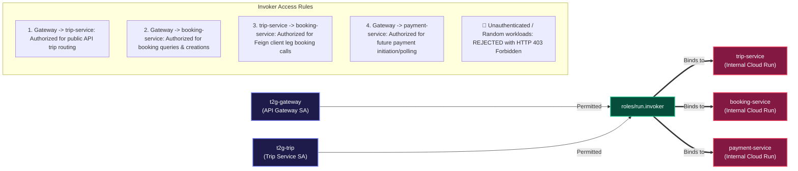

# Travel2Go — Google Cloud Services, Architecture & IAM Security Matrix

This document provides a comprehensive, graphical, and tabular blueprint of all Google Cloud Platform (GCP) services, dedicated runtime service accounts, and least-privilege IAM permissions configured across the Travel2Go production infrastructure.

---

## 1. High-Level GCP Architecture & Service Topology

The diagram below illustrates the end-to-end cloud topology, showing how external client traffic enters via Firebase Hosting and the Edge API Gateway, how internal microservices interact under Zero-Trust IAM isolation, and how data persists across Google Cloud Managed services.

```mermaid
flowchart TB
    %% STYLING
    classDef clientStyle fill:#1e293b,stroke:#38bdf8,stroke-width:2px,color:#f8fafc;
    classDef gatewayStyle fill:#0f172a,stroke:#818cf8,stroke-width:2px,color:#f8fafc;
    classDef pubSvcStyle fill:#1e293b,stroke:#34d399,stroke-width:2px,color:#f8fafc;
    classDef intSvcStyle fill:#1e1e38,stroke:#f43f5e,stroke-width:2px,stroke-dasharray: 5 5,color:#f8fafc;
    classDef dataStyle fill:#172554,stroke:#60a5fa,stroke-width:2px,color:#f8fafc;
    classDef iamStyle fill:#311b92,stroke:#c084fc,stroke-width:2px,color:#f8fafc;
    classDef opsStyle fill:#042f2e,stroke:#2dd4bf,stroke-width:2px,color:#f8fafc;

    subgraph CLIENT_EDGE ["Client Tier & Edge Ingress"]
        CLIENT["🌐 React 19 SPA (Users / Admins)"]:::clientStyle
        FIREBASE["🔥 Firebase Hosting\ntravel2go-495007.web.app"]:::clientStyle
        CLIENT -->|HTTPS / CDN| FIREBASE
    end

    subgraph INGRESS_LAYER ["Public Edge Ingress (Cloud Run)"]
        GATEWAY["🚪 api-gateway\nSA: t2g-gateway\nPublic Ingress | Port 8080"]:::gatewayStyle
        FIREBASE -->|API Requests / JWT| GATEWAY
    end

    subgraph PUBLIC_MICROSERVICES ["Public Cloud Run Services (Allow Unauthenticated)"]
        ID_SVC["🆔 identity-service\nSA: t2g-identity\nAuth, OAuth2, OTP"]:::pubSvcStyle
        PKG_SVC["📦 package-service\nSA: t2g-package\nHoliday Packages & Rules"]:::pubSvcStyle
        MEDIA_SVC["🖼️ media-service\nSA: t2g-media\nUploads & Asset API"]:::pubSvcStyle
        NOTIF_SVC["📨 notification-service\nSA: t2g-notification\nEmail / SMS / Invoices"]:::pubSvcStyle
        REACT_FN["⚡ reactive-booking-function\nSA: t2g-reactive\nEvent Aggregator"]:::pubSvcStyle
    end

    subgraph INTERNAL_MICROSERVICES ["Internal Zero-Trust Cloud Run Services (No Unauthenticated)"]
        TRIP_SVC["🧭 trip-service\nSA: t2g-trip\nJourney Spine & Pricing Quotes"]:::intSvcStyle
        BOOK_SVC["📋 booking-service\nSA: t2g-booking\nLeg Bookings & CRM Leads"]:::intSvcStyle
        PAY_SVC["💳 payment-service\nSA: t2g-payment\nDouble-Entry Money Ledger"]:::intSvcStyle
    end

    GATEWAY -->|HTTP / Bearer JWT| ID_SVC
    GATEWAY -->|HTTP / Bearer JWT| PKG_SVC
    GATEWAY -->|HTTP / Bearer JWT| MEDIA_SVC
    GATEWAY -->|HTTP / Bearer JWT| NOTIF_SVC

    %% IAM Invoker Protected Routes
    GATEWAY ==>|roles/run.invoker| TRIP_SVC
    GATEWAY ==>|roles/run.invoker| BOOK_SVC
    GATEWAY ==>|roles/run.invoker| PAY_SVC
    TRIP_SVC ==>|roles/run.invoker\n(Feign Client)| BOOK_SVC

    subgraph STORAGE_AND_DATA ["GCP Persistence & Managed Storage"]
        FIRESTORE[("🔥 Google Cloud Firestore\nReactive NoSQL Collections\n(asia-south2)")]:::dataStyle
        CLOUDSQL[("🐘 Cloud SQL PostgreSQL 15\nt2g-payments (db-f1-micro)\n(Transactional Outbox)")]:::dataStyle
        GCS_MEDIA[("🪣 Cloud Storage\ntravel2go-media-bucket\n(Asset Storage)")]:::dataStyle
        GCS_EMAIL[("🪣 Cloud Storage\ntravel2go-email-archives\n(Template Storage)")]:::dataStyle
    end

    subgraph CLOUD_OPERATIONS ["Google Cloud Operations (Observability)"]
        LOGGING["📝 Cloud Logging\nroles/logging.logWriter"]:::opsStyle
        MONITORING["📈 Cloud Monitoring\nroles/monitoring.metricWriter"]:::opsStyle
    end

    %% Firestore Connections
    ID_SVC -->|roles/datastore.user| FIRESTORE
    PKG_SVC -->|roles/datastore.user| FIRESTORE
    BOOK_SVC -->|roles/datastore.user| FIRESTORE
    MEDIA_SVC -->|roles/datastore.user| FIRESTORE
    NOTIF_SVC -->|roles/datastore.user| FIRESTORE
    TRIP_SVC -->|roles/datastore.user| FIRESTORE
    PAY_SVC -->|roles/datastore.user| FIRESTORE
    REACT_FN -->|roles/datastore.user| FIRESTORE

    %% Storage Connections
    MEDIA_SVC -->|roles/storage.objectAdmin| GCS_MEDIA
    ID_SVC -.->|roles/storage.objectViewer| GCS_MEDIA
    PKG_SVC -.->|roles/storage.objectViewer| GCS_MEDIA
    BOOK_SVC -.->|roles/storage.objectViewer| GCS_MEDIA
    NOTIF_SVC -.->|roles/storage.objectViewer| GCS_MEDIA
    NOTIF_SVC -->|roles/storage.objectViewer| GCS_EMAIL

    %% Cloud SQL
    PAY_SVC ==>|roles/cloudsql.client\nJDBC Socket Factory| CLOUDSQL

    %% Observability Connections
    ID_SVC & PKG_SVC & BOOK_SVC & MEDIA_SVC & NOTIF_SVC & TRIP_SVC & PAY_SVC & GATEWAY & REACT_FN -.-> LOGGING
    ID_SVC & PKG_SVC & BOOK_SVC & MEDIA_SVC & NOTIF_SVC & TRIP_SVC & PAY_SVC & GATEWAY & REACT_FN -.-> MONITORING
```

---

## 2. Zero-Trust Cloud Run Invoker IAM Topology

Internal microservices run with `--no-allow-unauthenticated`. They can **only** be invoked when a caller presents an OIDC Identity Token issued for an authorized Service Account holding `roles/run.invoker` on that specific service.



---

## 3. Dedicated Service Accounts Inventory

Replacing the broad default compute service account (`<project-number>-compute@developer.gserviceaccount.com`), Travel2Go deploys **9 dedicated runtime service accounts** plus **1 CI/CD deployer service account**:

| Service Account Email | Associated Cloud Run Service | Ingress Exposure | Primary Purpose |
| :--- | :--- | :--- | :--- |
| `t2g-gateway@travel2go-495007.iam.gserviceaccount.com` | `api-gateway` | **Public** (`allUsers`) | Dynamic request routing, JWT validation pass-through, invoker token generation |
| `t2g-identity@travel2go-495007.iam.gserviceaccount.com` | `identity-service` | **Public** | Google OAuth2, SMS OTP, User authentication, Firestore users collection |
| `t2g-package@travel2go-495007.iam.gserviceaccount.com` | `package-service` | **Public** | Holiday packages catalog, rules, Firestore package collections |
| `t2g-media@travel2go-495007.iam.gserviceaccount.com` | `media-service` | **Public** | GCS file uploads, asset metadata management |
| `t2g-notification@travel2go-495007.iam.gserviceaccount.com` | `notification-service` | **Public** | Email / SMS delivery, PDF generation, email bucket template access |
| `t2g-reactive@travel2go-495007.iam.gserviceaccount.com` | `reactive-booking-function` | **Public** | Realtime stream processing, booking metrics, Firestore state |
| `t2g-trip@travel2go-495007.iam.gserviceaccount.com` | `trip-service` | **Internal** (`--no-allow-unauthenticated`) | Journey spine, pricing engine, quote HMAC signing, calls booking-service |
| `t2g-booking@travel2go-495007.iam.gserviceaccount.com` | `booking-service` | **Internal** (`--no-allow-unauthenticated`) | Leg bookings, status lifecycle, CRM leads, Firestore bookings |
| `t2g-payment@travel2go-495007.iam.gserviceaccount.com` | `payment-service` | **Internal** (`--no-allow-unauthenticated`) | Double-entry money ledger, Cloud SQL PostgreSQL client, Razorpay handling |
| *Deployer CI Identity* (`GCP_CREDENTIALS`) | *GitHub Actions CI/CD* | **N/A (CI Pipeline)** | Holds `roles/iam.serviceAccountUser` on each SA to deploy Cloud Run services |

---

## 4. Comprehensive IAM Permissions Matrix

| Service Account | Cloud Logging<br>`roles/logging.logWriter` | Cloud Monitoring<br>`roles/monitoring.metricWriter` | Cloud Firestore<br>`roles/datastore.user` | GCS Media Bucket<br>`travel2go-media-bucket` | GCS Email Bucket<br>`travel2go-email-archives` | Cloud SQL<br>`roles/cloudsql.client` | Cloud Run Invoker<br>`roles/run.invoker` Targets |
| :--- | :---: | :---: | :---: | :---: | :---: | :---: | :--- |
| **`t2g-gateway`** | ✅ | ✅ | ❌ *(No datastore access)* | ❌ | ❌ | ❌ | Can invoke `trip-service`, `booking-service`, `payment-service` |
| **`t2g-identity`** | ✅ | ✅ | ✅ | 👁️ `objectViewer` | ❌ | ❌ | Publicly invokable via Gateway |
| **`t2g-package`** | ✅ | ✅ | ✅ | 👁️ `objectViewer` | ❌ | ❌ | Publicly invokable via Gateway |
| **`t2g-media`** | ✅ | ✅ | ✅ | ✍️ `objectAdmin` *(Full Read/Write)* | ❌ | ❌ | Publicly invokable via Gateway |
| **`t2g-notification`** | ✅ | ✅ | ✅ | 👁️ `objectViewer` | 👁️ `objectViewer` | ❌ | Publicly invokable via Gateway |
| **`t2g-reactive`** | ✅ | ✅ | ✅ | ❌ | ❌ | ❌ | Publicly invokable |
| **`t2g-trip`** | ✅ | ✅ | ✅ | ❌ | ❌ | ❌ | Can invoke `booking-service`; Invokable only by `t2g-gateway` |
| **`t2g-booking`** | ✅ | ✅ | ✅ | 👁️ `objectViewer` | ❌ | ❌ | Invokable only by `t2g-gateway` & `t2g-trip` |
| **`t2g-payment`** | ✅ | ✅ | ✅ | ❌ | ❌ | 🐘 `roles/cloudsql.client` | Invokable only by `t2g-gateway` |
| **CI Deployer SA** | 🔧 Admin | 🔧 Admin | 🔧 Admin | 🔧 Admin | 🔧 Admin | 🔧 Admin | Holds `roles/iam.serviceAccountUser` across all 9 SAs |

---

## 5. Google Cloud Resource Specifications

### 1. Cloud Run Fleet
- **Platform**: Fully Managed Serverless (`asia-south2`)
- **Port**: 8080 across all services
- **Scaling Bounds**:
  - `api-gateway`: Min instances: 1 (always warm for instant ingress), Max instances: 3, Concurrency: 80, Timeout: 60s
  - Backends: Min instances: 0, Max instances: 3, Concurrency: 80, Timeout: 300s, CPU Boost: Enabled
- **Startup Health Probes**:
  - Configured on `/actuator/health/readiness` for `api-gateway`, `identity-service`, `booking-service`, `trip-service`.
  - Initial delay: 10s, Period: 5s, Failure threshold: 12, Timeout: 3s.

### 2. Cloud SQL PostgreSQL 15 Instance (`t2g-payments`)
- **Database Engine**: PostgreSQL 15 (`POSTGRES_15`)
- **Instance Tier**: `db-f1-micro` (development / scalable to high-availability in production)
- **Region**: `asia-south2` (Delhi)
- **Storage**: 10GB SSD with automatic backups enabled
- **Connectivity**: Reached via Cloud SQL JDBC Socket Factory (`com.google.cloud.sql.postgres.SocketFactory`), eliminating the overhead and cost of a Serverless VPC Access Connector.

### 3. Google Cloud Storage Buckets
- **Uniform Bucket-Level Access**: Enforced on all buckets.
- **`travel2go-media-bucket`**:
  - Purpose: Package promotional images, itinerary brochures, user profile avatars.
  - Writer: `t2g-media` (`roles/storage.objectAdmin`)
  - Readers: `t2g-identity`, `t2g-package`, `t2g-booking`, `t2g-notification` (`roles/storage.objectViewer`)
- **`travel2go-email-archives`**:
  - Purpose: Email templates, PDF invoice archives, logo assets.
  - Reader: `t2g-notification` (`roles/storage.objectViewer`)

### 4. Google Artifact Registry
- **Repository**: `cloud-run-source-deploy` (`docker` format, `asia-south2`)
- **URL**: `asia-south2-docker.pkg.dev/travel2go-495007/cloud-run-source-deploy/<service-name>:latest`
- **Security**: Immutable tagged SHA container images pushed via GitHub Actions workflow.

### 5. Firebase Hosting
- **Domain**: `travel2go-495007.web.app` / `travel2go-495007.firebaseapp.com`
- **Build**: Single-Page Application (SPA) built with React 19 + Vite, pre-configured with `VITE_API_URL` pointing directly to the Cloud Run `api-gateway` URL.
